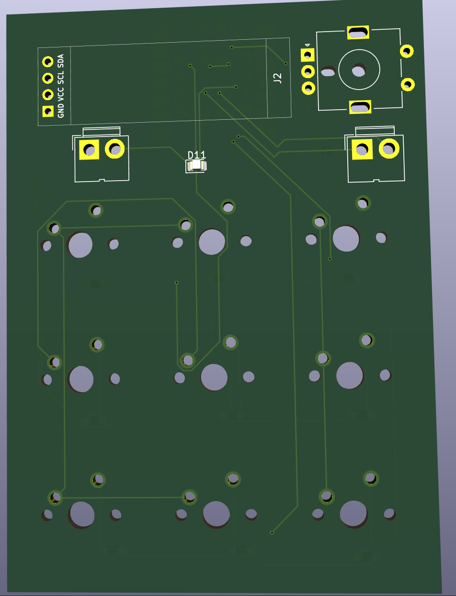
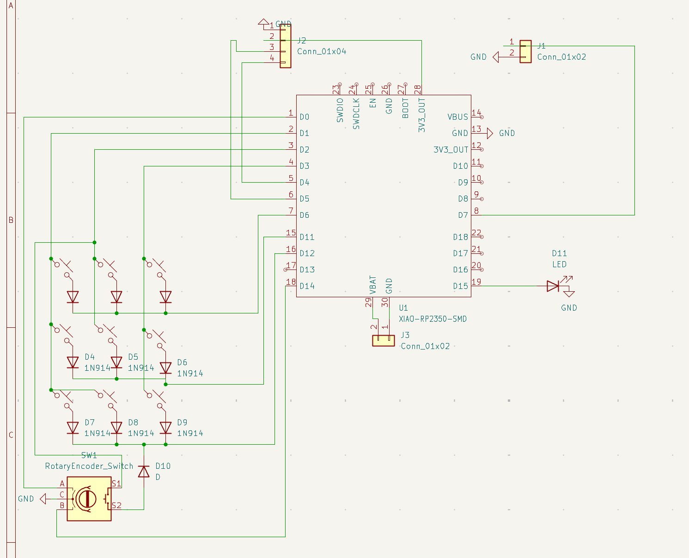

# XIAO-RP2350-Timer
I made this project in order to track the time i spend when doing certain tasks but i didn't want to use my phone in order to avoid distraction as well as when i study or work during the school day when i don't have my phone on me. originally the plan was to use an rp2040 chip with components but it proved too complicated for me to use and required equipment i didn't have. I decided on a xiao rp2350 as it already had lipo battery use prebuilt and was small to allow for the small form factor i was aiming for. 
## Parts List

| Item | Price | Link|
|---|---:|---|
| XIAO RP2350 | $1.09 | [AliExpress](https://www.aliexpress.us/item/3256812349541468.html) |
| Diodes | $2.49 | [AliExpress](https://www.aliexpress.us/item/3256807166031523.html) |
| LiPo battery | $1.09 | [AliExpress](https://www.aliexpress.us/item/3256803193874231.html) |
| Cherry switches | $0.33 | AliExpress — 3 for $0.99 |
| Buzzers | $0.33 | AliExpress — 3 for $0.99 |
| 0.91-inch OLED screen | $0.33 | AliExpress — 3 for $0.99 |
| LED diodes | $3.41 | [AliExpress](https://www.aliexpress.us/item/3256810339576661.html) |
| PCB | $11.01 | [JLCPCB](https://jlcpcb.com/) |
| Liquid flux | $4.85 | [AliExpress](https://www.aliexpress.us/item/3256804676815166.html) |
| **Total** | **$24.93** | |

